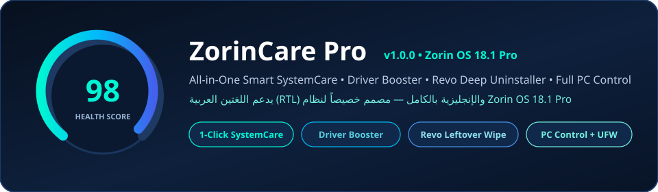

<p align="center">
  
</p>

# ZorinCare Pro (`zorincare-pro`)

**All-in-One Smart SystemCare, Driver & Firmware Booster, Revo-Style Deep Uninstaller, and Full PC Control Center built natively for Zorin OS 18.1 Pro (Ubuntu 24.04 LTS Noble / Linux Kernel 6.17).**

> **ثنائي اللغة بالكامل (English + العربية RTL):** يمكنك التبديل الفوري بين اللغة الإنجليزية والعربية مع دعم اتجاه الواجهة من اليمين إلى اليسار بنقرة واحدة من الشريط العلوي.

---

## Key Features

### 1. AI Smart SystemCare *(IObit Advanced SystemCare Style)*
- **Animated Radial Health Score Gauge (`0–100`)** with **1-Click Scan & Fix**.
- **12-Point Deep Cleanup**:
  - APT `.deb` package cache (`/var/cache/apt/archives`)
  - Orphaned APT dependencies (`apt-get autoremove --purge`)
  - Residual removed package configs (`dpkg` `rc` state)
  - Unused Flatpak runtimes (`flatpak uninstall --unused`)
  - Disabled old Snap revisions (`/var/lib/snapd/snaps`)
  - Systemd journal logs vacuuming (`> 50 MB`)
  - Rotated & compressed `/var/log/*.gz` archives
  - User thumbnail cache, safe developer/shader caches (`pip`, `npm`, `Mesa`), crash dumps, Recycle Bin, and broken symlinks.
- **Single-Prompt Polkit Elevation**: Batches all privileged cleanup actions into one `pkexec` session (`auth_admin_keep`).

### 2. Turbo Boost & Kernel 6.17 Optimizer
- **1-Click RAM Memory Booster**: Flushes clean pagecache, dentries, and inodes safely without closing open apps.
- **Boost Modes**: **Gaming Turbo Boost**, **Work Pro Boost**, **Max Battery Saver**, and **Balanced Default**.
- **Persistent `sysctl` Kernel Tweaks** (`/etc/sysctl.d/99-zorincare-pro.conf`) with 1-click reset:
  - Low Swappiness (`vm.swappiness = 10`)
  - Responsive VFS Cache (`vm.vfs_cache_pressure = 50`)
  - Smooth USB/NVMe Writeback (`vm.dirty_ratio = 15`)
  - **Google BBR** TCP Congestion Control (`bbr` + `fq`)
  - **Gaming / Steam Proton / Zorin Windows App Support** max map count (`vm.max_map_count = 2147483642`)

### 3. Driver & Firmware Booster *(IObit Driver Booster Style)*
- **Proprietary GPU & Wi-Fi Drivers** via `ubuntu-drivers` (NVIDIA, Broadcom, Realtek) with **Recommended** detection and 1-click install.
- **UEFI BIOS & Device Firmware Updates** via `fwupdmgr` (LVFS).
- **Stack Health Check**: Linux Kernel 6.17 HWE, Intel/AMD CPU Microcode, Mesa Vulkan drivers, DKMS module health, and Zorin Restricted Multimedia Codecs.
- **Hardware Controller Inspector**: Live `lspci -nnk` & `lsusb` hardware map flagging any controller missing an active kernel driver.

### 4. Revo-Style Deep Uninstaller & Leftover Hunter
- **Universal App Catalog**: Manages **APT (`.deb`)**, **Flatpak**, **Snap**, **AppImage**, and **Wine / Zorin Windows App Support** apps in one place (with core Zorin OS package protection).
- **3-Depth Leftover Scanner (`Safe` / `Moderate` / `Advanced`)**: Hunts leftover configs, caches, sandboxes, and launchers across `~/.config`, `~/.cache`, `~/.local/share`, `~/.local/state`, `~/.var/app`, `~/snap`, `/opt`, `/etc`, and `/var/lib`.
- **Ghost / Orphan Leftover Hunter**: Finds leftover data folders from apps you *already* uninstalled in the past!
- **Safety Backup & Restore**: Optionally creates compressed `.tar.gz` backups before deleting app data, restorable anytime in one click.

### 5. Full PC Control Center + Security & Privacy Shield
- **Live Hardware Telemetry**: Real-time CPU %, MHz, Thermal Sensors (`°C`), RAM, Swap/ZRAM, Network Download/Upload speeds, Root Disk, Uptime & Battery.
- **Task Manager**: Searchable live process table with **End Process (`SIGTERM`)** and **Force Kill (`SIGKILL`)**.
- **Startup & Systemd Services**: Toggle `~/.config/autostart` apps and start/stop/restart background `systemd` services.
- **Quick System Controls**: 1-Click DNS Switcher (Cloudflare `1.1.1.1`, Google `8.8.8.8`, Quad9 `9.9.9.9`, DHCP Auto), Scheduled Shutdown Timer, Zorin OS / GNOME 46 desktop quick tweaks (`gsettings`), and Home Disk Space Analyzer.
- **Security & Privacy Shield**: UFW Firewall toggle, active listening TCP/UDP port auditor (`ss -tulnp`), `~/.ssh` permissions check, and Browser/Activity privacy sweep (Brave, Firefox, Chrome, Chromium, Edge, `recently-used.xbel`).

---

## Installation on Zorin OS 18.1 Pro

### Option A: 1-Line Terminal Install (Fastest)
```bash
curl -fsSL https://raw.githubusercontent.com/vaasiraq-art/zorincare-pro/main/install.sh | bash
```

### Option B: Download & Install `.deb` Package Directly
Download **`zorincare-pro_1.0.0_all.deb`** from [**Releases**](https://github.com/vaasiraq-art/zorincare-pro/releases/latest) and double-click it in **Zorin Files**, or run:
```bash
wget -O zorincare-pro_1.0.0_all.deb https://github.com/vaasiraq-art/zorincare-pro/releases/download/v1.0.0/zorincare-pro_1.0.0_all.deb
sudo apt install ./zorincare-pro_1.0.0_all.deb
```

### Option C: Clone & Build Locally
```bash
git clone https://github.com/vaasiraq-art/zorincare-pro.git
cd zorincare-pro
./install.sh
```

---

## التثبيت السريع على نظام Zorin OS 18.1 Pro (العربية)

1. قم بتحميل ملف الحزمة **`zorincare-pro_1.0.0_all.deb`** من قسم **Releases** ثم انقر عليه مرتين للتثبيت، أو نفّذ الأمر التالي في الطرفية (Terminal):
```bash
sudo apt install ./zorincare-pro_1.0.0_all.deb
```
2. أو عبر السكربت التلقائي من المستودع مباشرة:
```bash
chmod +x install.sh && ./install.sh
```
3. افتح البرنامج من **قائمة زورين ← أدوات النظام ← ZorinCare Pro** أو عبر الأمر `zorincare-pro`، واضغط زر **`العربية`** في أعلى النافذة للتبديل الفوري إلى الواجهة العربية الكاملة.

---

## CLI Usage & Development

```bash
# Launch GTK4 + Libadwaita GUI
zorincare-pro

# Launch directly in Arabic (RTL)
zorincare-pro --lang ar

# Run non-interactive 12-point terminal health scan
zorincare-pro --cli-scan

# Run automated unit tests
python3 -m unittest discover -s tests -v

# Build .deb package into dist/
python3 scripts/build_deb.py
```

## License
MIT License — see [LICENSE](LICENSE).
